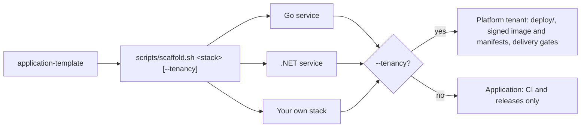

# application-template

Start a new devantler-tech application from one template: pick a **Go**, **.NET** or
bring-your-own stack, and choose whether it runs on the
[devantler-tech platform](https://github.com/devantler-tech/platform) as a **tenant**. One
command lays down the stack and, if you want it, the tenancy; a weekly sync keeps the shared
plumbing current afterwards.

This template replaces three starters that could not be combined: `go-template` and
`dotnet-template` had no platform tenancy, and the tenant starter, formerly called
`platform-tenant-template`, had no language stack. An application could only follow one of
them.



## What you get

| Choice | Adds |
|---|---|
| `go` | A Go `net/http` server with OpenFeature feature flags, table-driven tests, golangci-lint v2 and the shared Go validator in CI |
| `dotnet` | An ASP.NET Core minimal API on .NET 11 with OpenFeature, xUnit v3 tests and warnings-as-errors analyzers, built and tested in CI |
| `none` | A placeholder CI job and Dockerfile, for a stack you bring yourself, such as Node |
| `--tenancy` | `deploy/` Kustomize manifests, a signed image and manifests release on every `v*` tag, and CI that builds the image and renders `deploy/` before merge |

Every application gets Conventional-Commit releases, Dependabot, agent instructions
([`AGENTS.md`](AGENTS.md)) and the weekly template sync. Both stacks serve a placeholder page at
`GET /` on port 3000, which is where the tenant's probes look, so a new tenant deploys before you
write any code.

## Try it locally

You need Git and a POSIX shell. To build the result you also need the stack's toolchain (a Go
toolchain meeting its `go.mod`, or the .NET SDK its `global.json` names) or Docker. No GitHub
token, cloud account or cluster is needed. This scaffolds a Go tenant in a throwaway copy:

```sh
git clone --depth 1 https://github.com/devantler-tech/platform-tenant-template.git demo-app
cd demo-app
rm -rf .git
scripts/scaffold.sh go --tenancy
go test ./...
```

Success is the scaffold printing `Scaffolded 'demo-app' (stack: go, platform tenant: yes).`
and the tests passing. `kubectl kustomize deploy/` then renders the tenant's manifests and
`docker build .` builds its image. The scaffold refuses to run in a checkout of this template
itself, which is why the copy drops `.git`.

To improve this upstream template, follow [CONTRIBUTING.md](CONTRIBUTING.md).

## Create an application

Creation is currently blocked until [#211](https://github.com/devantler-tech/platform-tenant-template/issues/211)
enables this repository as a GitHub template. Trying it locally and contributing still work.

1. **Create the repository from this template.** This is an organization write, not local
   setup; follow the repository-creation process of your organization.
2. **Scaffold it.** In your new repository's checkout, run
   [`scripts/scaffold.sh`](scripts/scaffold.sh) once with your stack, and `--tenancy` if it will
   run on the platform:

   ```sh
   scripts/scaffold.sh go --tenancy
   ```

   The name defaults to the directory name and must equal the repository name; pass it as the
   last argument to choose it yourself. [What the scaffold changes](docs/REFERENCE.md#what-the-scaffold-changes)
   lists everything it touches. Review `git status` and `git diff`, then commit.
3. **Make it yours.** Replace the placeholder page with your app, fill in the remaining
   placeholders in `AGENTS.md`, and replace `README.md` and `CONTRIBUTING.md` with your own.
4. **Protect your own files from the weekly sync.** Tailor the supplied
   [`.templatesyncignore`](.templatesyncignore). [The ownership reference](docs/REFERENCE.md#what-the-template-owns-vs-what-you-own)
   explains which files sync may replace. Sync needs the configured GitHub App credentials.
   Existing applications must confirm their own ignore file contains `CONTRIBUTING.md` before
   the sync runs. The current workflow merges new ignore entries, but an older consumer
   workflow may not; add and commit the entry yourself if missing. If a sync PR is already
   open, restore your tailored guide and commit the ignore entry before merging it: the entry
   does not undo changes already proposed.
5. **Register a tenant on the platform.** Follow
   [`platform/docs/TENANTS.md`](https://github.com/devantler-tech/platform/blob/main/docs/TENANTS.md).

Default PR CI always builds the tenant image and renders `deploy/` before merge, using no
secrets or write authority. Keep the `delivery-inputs` job and its entry in
`ci-required-checks` when you change the stack job. This catches the same image and manifest
failures in the pull request that introduced them instead of during release or reconciliation.
Keep the `publish-pin-approved` job and its entry too: it holds back a dependency update that
moves the publishing workflow to a revision the platform has not yet approved for your tenant,
so the release it would cut does not fail to deploy. An application scaffolded without
`--tenancy` has neither job.

After authorized App setup and platform registration, eligible Conventional Commits can produce
tags that trigger the signed publishing pipeline. Neither a local render nor the presence of
workflow files proves publication or a live deployment. [How publishing works](docs/REFERENCE.md#how-publishing-works)
explains the handoff and checks. Release and publication intentionally no-op in this upstream
template repository.

## Reference

[`docs/REFERENCE.md`](docs/REFERENCE.md) covers what the scaffold and the rename change, which
files the template keeps in sync and which are yours, how publishing works, and how to validate
the template locally.

The template is [Apache-2.0 licensed](LICENSE). Upstream community and private
security-reporting routes are in [CONTRIBUTING.md](CONTRIBUTING.md); applications own their own
contribution and disclosure policies.
